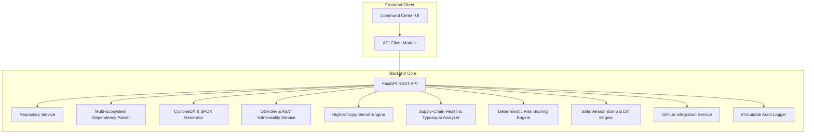

# PATCHPROOF — ARCHITECTURE & COMPONENT MODEL

## High-Level Overview

PATCHPROOF is structured into a modular Python FastAPI backend and a high-performance React / TypeScript single-page application.

## Backend Services Breakdown

1. **`repository_service.py`**:
   - Manages shallow git cloning (`--depth 1`), commit SHA pinning, and temporary directory cleanup.
   - Prevents SSRF and malicious paths.

2. **`dependency_parser.py`**:
   - Parses `requirements.txt`, `pyproject.toml`, `package.json`, `package-lock.json`, `go.mod`, and `pom.xml`.
   - Generates Package URLs (PURLs) and distinguishes direct from transitive dependencies.

3. **`sbom_service.py`**:
   - Generates standard CycloneDX 1.5 JSON and SPDX 2.3 JSON documents with component metadata and dependency graphs.

4. **`vulnerability_service.py`**:
   - Connects to OSV.dev batch API, fetches advisory details, resolves fixed versions, correlates CISA KEV status, and estimates EPSS probabilities.
   - Deduplicates findings across CVE and GHSA aliases.

5. **`secret_scanner.py`**:
   - Scans files and recent Git commit logs for AWS, GitHub, OpenAI, Slack, Stripe, and private key credentials.
   - Redacts all secrets immediately before data enters application models.

6. **`dependency_health.py`**:
   - Analyzes potential typosquatting using Levenshtein distance against top open-source libraries.
   - Flags suspicious lifecycle scripts (`preinstall`, `postinstall`).

7. **`risk_engine.py`**:
   - Calculates deterministic risk scores (0–100) combining CVSS, KEV weaponization, EPSS probability, and reachability.

8. **`remediation_service.py`**:
   - Calculates the minimum safe version bump that satisfies all advisory constraints.
   - Generates unified manifest diffs (`difflib`) and recommends targeted test commands.

9. **`github_service.py`**:
   - Proposes branch names and formats markdown draft pull request bodies.
   - Strictly opens pull requests in **DRAFT** mode (`draft=True`).
   - Architectural safeguard: `merge_pull_request` is explicitly blocked.

10. **`audit_service.py`**:
    - Creates tamper-evident logs with SHA-256 integrity hashes for every pipeline event.

