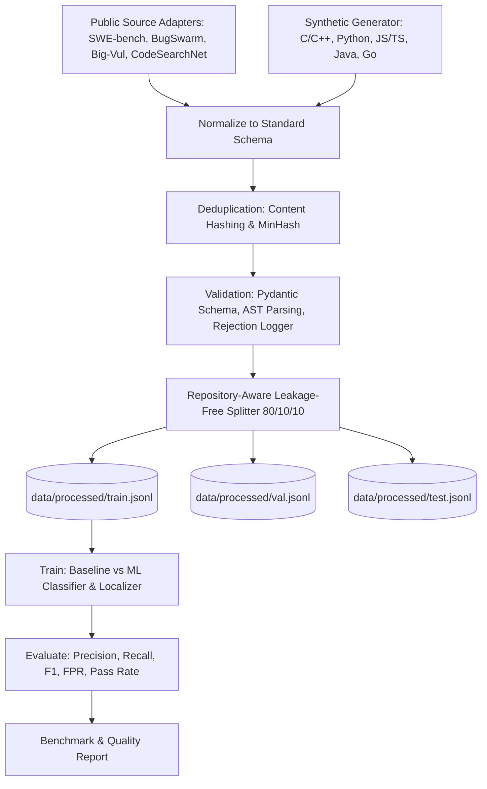

# PATCHPROOF — ML CODE-DEBUGGING DATASET PIPELINE SPECIFICATION

## 1. Executive Summary & Hardware Strategy

PATCHPROOF is expanding its developer-security platform with an interactive AI-powered code debugging and bug-finding engine. This specification details the architecture for an end-to-end, reproducible dataset and model training pipeline capable of curating 50,000–100,000 high-quality code-debugging examples.

### Hardware & Environment Constraints
- **Host Architecture:** Standard workstation, Windows OS, Python 3.12 64-bit.
- **Compute Capabilities:** Multi-core CPU; no GPU or paid LLM APIs assumed.
- **Machine Learning Toolchain:** `scikit-learn` 1.9+, `numpy` 2.5+, `scipy`, `pandas`, `joblib`, standard Python AST and Pygments tokenizers.
- **Training Strategy:** 
  1. **Interpretable Machine Learning Classifier & Localizer:** Feature extraction combining character/token n-grams, AST structural metrics (cyclomatic complexity, nesting depth, error-handling constructs), and code defect patterns with regularized Logistic Regression and Gradient Boosted trees.
  2. **Semantic Retrieval Engine:** TF-IDF and dense feature similarity index for nearest-neighbor bug retrieval and verified patch suggestion.
  3. **Foundation Model Compatibility:** All datasets are emitted in standardized JSONL formats ready for direct fine-tuning of CodeLlama, StarCoder, or Qwen-Coder when GPU clusters are available.

---

## 2. Source Datasets & Licensing Evaluation

| Dataset | Primary Ecosystem | Purpose | Access & Licensing Policy |
| :--- | :--- | :--- | :--- |
| **SWE-bench** | Python | Real-world GitHub issue-PR pairs with verified test harnesses | Open access (MIT / Apache-2.0 / BSD depending on upstream repos). Preserves commit SHA and repo metadata. |
| **BugSwarm** | Python, Java | Reproducible build/test failure and pass pairs | Academic/Research open dataset. Preserves pass/fail build artifacts. |
| **Big-Vul** | C / C++ | Vulnerability dataset extracted from CVE commits with unified diffs | Open research dataset. Preserves CVE IDs and commit links. |
| **CodeSearchNet** | Multi-language | **Hard Negatives & Controls (Correct Code)** | Open dataset (permissive licenses). **Strictly treated as unlabelled clean code controls**, NOT as a labelled bug source. |
| **PATCHPROOF Synthetic** | C/C++, Python, JS/TS, Java, Go | Controlled, realistic defects across 18 bug categories + controls | Proprietary/Open synthetic generator with parameterized seed mutations and test cases. |

---

## 3. Common JSONL Schema (`schema.jsonl`)

Every dataset record strictly adheres to the following JSON schema:

```json
{
  "example_id": "pp-dbg-1a2b3c4d-5e6f",
  "language": "python",
  "bug_category": "off_by_one",
  "difficulty": "medium",
  "original_code": "def binary_search(arr, target):\n    low, high = 0, len(arr)\n    while low < high:...",
  "bug_description": "Upper bound off-by-one in binary search leads to IndexError when target is at last index.",
  "faulty_line_numbers": [2],
  "corrected_code": "def binary_search(arr, target):\n    low, high = 0, len(arr) - 1\n    while low <= high:...",
  "patch": "--- a/binary_search.py\n+++ b/binary_search.py\n@@ -2,2 +2,2 @@\n-    low, high = 0, len(arr)\n+    low, high = 0, len(arr) - 1",
  "test_cases": [
    {"input": "([1, 3, 5, 7], 7)", "expected": "3", "test_type": "unit"}
  ],
  "verification_status": "verified_passing",
  "source_dataset": "synthetic_patchproof",
  "source_record_id": "syn-py-offbyone-0042",
  "repository": "patchproof/synthetic-bench",
  "commit_hash": "e3b0c44298fc1c149afbf4c8996fb92427ae41e4649b934ca495991b7852b855",
  "license": "Apache-2.0",
  "duplicate_group_id": "dg-7f8e9d0a",
  "split": "train"
}
```

---

## 4. Leakage Prevention & Data Splitting

- **Grouping Strategy:** Grouped by `duplicate_group_id` and `repository` to guarantee that all variants, mutant variations, or multiple commits from the same repository belong exclusively to one split.
- **Split Proportions:** 80% Training, 10% Validation, 10% Testing.
- **Reproducibility:** Constant random seed `42` pinned across all runs.

---

## 5. Pipeline Architecture



