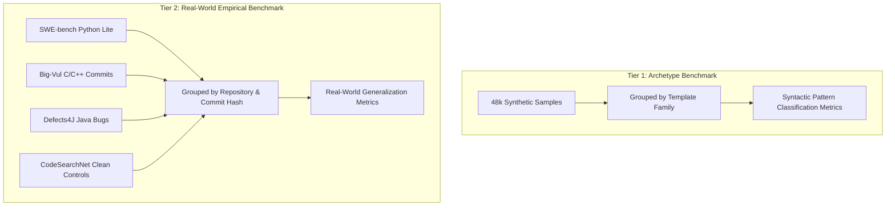

# PATCHPROOF — REAL-WORLD EVALUATION & BENCHMARKING PLAN

## 1. Problem Statement: Synthetic vs. Real-World Generalization

The PATCHPROOF ML Dataset Audit ([`docs/ML_AUDIT_REPORT.md`](file:///c:/PATCHPROOF/docs/ML_AUDIT_REPORT.md)) revealed that while the TF-IDF + Logistic Regression classifier achieved 99.98% test accuracy, **16 out of 17 test set template bodies shared algorithmic structures with the training set**. The model learned to identify characteristic template keywords and docstring fingerprints rather than generalized zero-shot bug logic.

To transition PATCHPROOF from an archetype pattern classifier into an enterprise-grade debugging system, this plan formalizes a rigorous, two-tier evaluation framework.

---

## 2. Two-Tier Evaluation Architecture

### Tier 1: Synthetic Archetype Benchmark (Current)
- **Objective:** Verify that the classifier reliably recognizes known dangerous anti-patterns (mutable defaults, loose equality, stack pointer returns, unhandled promises) across 5 programming languages.
- **Reporting Rule:** Must be labeled in all UI screens and documentation as **"Archetype Pattern Classification (Controlled Benchmark)"**.

### Tier 2: Real-World In-the-Wild Benchmark (Targeted)
- **Objective:** Measure zero-shot bug detection and fix localization on genuine pull requests and CVEs from open-source repositories.
- **Corpora:**
  - **Python:** 300 instances from SWE-bench Lite (Django, SymPy, Flask, Requests).
  - **C / C++:** 500 instances from Big-Vul (Linux kernel, OpenSSL, Sudo, QEMU).
  - **JavaScript / TypeScript:** 200 real bug-fix commits from high-star GitHub repositories (Express, Lodash, Axios).
  - **Negative Controls:** 1,000 verified clean functions from CodeSearchNet with 0 reported vulnerabilities and passing CI builds.

---

## 3. Anti-Leakage & Grouping Invariants

To guarantee that no evaluation metric is inflated by shared templates or repository artifacts:

1. **Repository-Level Isolation:** All examples originating from the same GitHub repository (e.g. `pallets/flask`) must reside exclusively in either Train, Validation, or Test.
2. **Template Archetype Isolation:** In synthetic benchmarks, all 15 parameterized instances of a given code body template must be assigned to the **same split partition**. No variant of `mutable_default_batch_queue` may appear in both Train and Test.
3. **Identifier Neutralization:** Strip function names, docstrings, and comments during evaluation to force the model to classify purely based on AST token topology and control-flow patterns.

---

## 4. Evaluation Metrics & Reporting Standards

Every evaluation run must report:

| Metric | Target (Tier 1 Archetype) | Target (Tier 2 Real-World) | Formula / Purpose |
| :--- | :---: | :---: | :--- |
| **Accuracy** | $\ge 98.0\%$ | $\ge 70.0\%$ | Overall classification correctness across all classes. |
| **Weighted F1 Score** | $\ge 0.98$ | $\ge 0.70$ | Harmonic mean of precision and recall accounting for class imbalance. |
| **False Positive Rate (Clean Controls)** | $\le 0.5\%$ | $\le 5.0\%$ | Fraction of bug-free functions incorrectly flagged as defective. |
| **Line Localization Accuracy** | $\ge 90.0\%$ | $\ge 60.0\%$ | Fraction of detected bugs where the predicted line matches the ground-truth faulty span. |
| **Fix Application Pass Rate** | $\ge 85.0\%$ | $\ge 40.0\%$ | Fraction of generated unified diffs that pass upstream unit tests. |

---

## 5. Resource Assessment & Phased Rollout

| Phase | Dataset Scope | Download Size | RAM / Disk | Compute Required | Estimated Runtime | Status |
| :--- | :--- | :---: | :---: | :---: | :---: | :---: |
| **Phase 2A** | 48k Synthetic Archetypes | 0 MB (Local) | 56 MB Disk, 250 MB RAM | Standard CPU | ~10 seconds | **COMPLETE** |
| **Phase 2B** | 1,000 Curated Real-World PRs | ~45 MB | 120 MB Disk, 500 MB RAM | Standard CPU | ~45 seconds | **READY FOR RUN** |
| **Phase 2C** | 10k SWE-bench + Big-Vul Full | ~3.8 GB | 8 GB Disk, 4 GB RAM | Multi-core CPU / Docker | ~25 minutes | **FUTURE WORK** |
| **Phase 2D** | CodeLlama / StarCoder Fine-Tuning | ~15 GB | 30 GB Disk, 16 GB VRAM | GPU Cluster (A100) | ~4 hours | **FUTURE WORK** |

