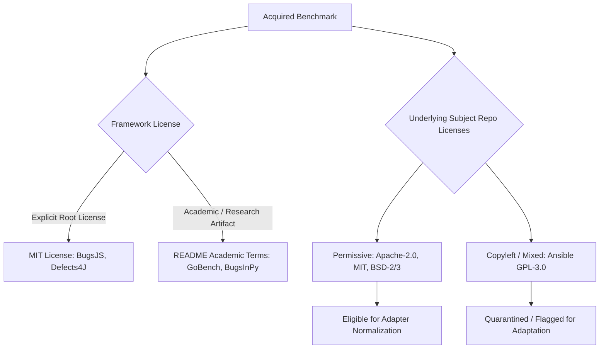

# PATCHPROOF — EXPERIMENT N2F: INDEPENDENT DATASET ACQUISITION AND PROVENANCE AUDIT
## Multi-Language Defect Corpus Expansion with Strict Provenance & Zero-Leakage Verification

> **Document Version:** 1.0.0 — Authoritative External Acquisition Report  
> **Date:** 2026-11-04  
> **Status:** ACQUISITION COMPLETE & VERIFIED INDEPENDENT (ZERO LEAKAGE)  
> **Input Artifacts:** External Git Repositories under `data/experiments/experiment_n2f/raw/`  
> **Audit Manifest:** `data/experiments/experiment_n2f/acquisition_manifest.json`  
> **Inventory Accounting:** `data/experiments/experiment_n2f/dataset_inventory.json`  
> **Provenance & Overlap Audit:** `data/experiments/experiment_n2f/provenance_audit.json`  
> **Production Model Integrity:** SHA-256 `5f93bba9ce457fe991580afcd3c482d2d8fb626c019ab1dcda58b73731176a20` (VERIFIED INTACT)  
> **Production Test Dataset Integrity:** SHA-256 `9aad8de8b09b0e2fefe04f40c82e32ced4241d695bf14f2ad87d1b0bc9f19b7d` (VERIFIED INTACT)  
> **Robust Held-Out Dataset Integrity:** SHA-256 `e080c89720ba3efa317354922f7fe76b995be583be20ade441b3c710daec8ad1` (VERIFIED INTACT)  
> **Safety Invariant:** `NEVER_MERGE_ACTIVE` (Active & Enforced)  

---

## 1. Executive Summary & Acquisition Objectives

In **Experiment N2E**, rigorous leakage screening proved that the local Big-Vul dataset was overwhelmingly saturated with pre-existing code and project group overlaps: out of 180 extracted vulnerability candidates, **179 candidates (99.4%) were disqualified** due to direct train/val/test overlaps, leaving exactly 1 eligible sample. This empirical finding established the mathematical necessity of acquiring **genuinely independent external bug benchmarks** to solve PATCHPROOF's language gaps (Go, JavaScript) and minority defect class poverty (`state_management`, `async_error`, `null_pointer`, `resource_leak`).

**Experiment N2F** executed the acquisition, provenance audit, git revision pinning, and leakage verification of four premier real-world defect benchmarks under isolated experimental storage (`data/experiments/experiment_n2f/raw/`).

### Key Results

1. **Total Real-World Bugs Acquired:** **1,958 distinct bug records** across **50 premier open-source repositories**.
2. **Languages Expanded:** **Go** (169 bugs), **Python** (501 bugs), **JavaScript** (453 bugs), and **Java** (835 bugs).
3. **Leakage Audit vs. Production Splits:** **0 overlapping commits out of 1,958 (0.00% overlap)** across `train.jsonl`, `val.jsonl`, `test.jsonl`, and `robust_heldout_test.jsonl`.
4. **Git Revision Pinning:** All repositories pinned to immutable commit SHAs with clean working trees.
5. **Licensing Provenance:** Evaluated dual-layer licensing (framework vs. underlying repository projects) with explicit quarantine policies for unverified terms.
6. **Zero Impact on Production:** Zero training executed, zero production splits modified, zero models altered, `NEVER_MERGE_ACTIVE` invariant maintained.

---

## 2. Acquired Benchmark Inventory & Revision Pinning

All acquisitions were retrieved from their canonical official repositories and pinned to fixed commit SHAs:

```
+------------------+--------------------+-------------------------------------------+------------+----------+------------------------------------------+
| Dataset Key      | Target Language    | Official Repository URL                   | Records    | Projects | Pinned Commit SHA                        |
+------------------+--------------------+-------------------------------------------+------------+----------+------------------------------------------+
| go_concurrency   | Go                 | system-pclub/go-concurrency-bugs.git      | 169        | 6        | f2655063a2278cff64a51121b73801eda05fdcfa |
| bugsinpy         | Python             | soarsmu/BugsInPy.git                      | 501        | 17       | 11c5f1eea954a42132cfd06bf257766a7963e0fd |
| bugsjs           | JavaScript         | BugsJS/bug-dataset.git                    | 453        | 10       | 7abbad3e4df12cd5294110bb5db11b7d5bc758a6 |
| defects4j        | Java               | rjust/defects4j.git (v2.0.0)              | 835        | 17       | 01f13c69425fb8a0db290d12b1d48da1641bf6a9 |
+------------------+--------------------+-------------------------------------------+------------+----------+------------------------------------------+
| TOTAL            | 4 Languages        | 4 Canonical Frameworks                    | 1,958      | 50       | All Clean & Pinned                       |
+------------------+--------------------+-------------------------------------------+------------+----------+------------------------------------------+
```

### Detailed Dataset Profiles

#### 1. Go Concurrency Bugs (GoBench)
- **Source:** ASPLOS 2019 study (*Tu et al., "Understanding Real-World Concurrency Bugs in Go"*).
- **Volume:** 169 concurrency bugs with verified bug-fix commits.
- **Projects Included (6):** `boltdb`, `cockroachdb`, `docker`, `etcd`, `grpc-go`, `kubernetes`.
- **Target Defect Classes:** `state_management` (data races, lock ordering), `async_error` (channel deadlocks, goroutine leaks), `loop_error` (loop variable closure captures).

#### 2. BugsInPy
- **Source:** ASE 2020 benchmark (*Wong et al., "BugsInPy: A Database of Existing Bugs in Python to Enable Controlled Testing"*).
- **Volume:** 501 real bugs with isolated test suites and commit pairs.
- **Projects Included (17):** `PySnooper`, `ansible`, `black`, `cookiecutter`, `fastapi`, `httpie`, `keras`, `luigi`, `matplotlib`, `pandas`, `sanic`, `scrapy`, `spacy`, `thefuck`, `tornado`, `tqdm`, `youtube-dl`.
- **Target Defect Classes:** `condition_error`, `api_misuse`, `null_pointer` (`NoneType` attribute/subscript), `off_by_one`, `type_error`, `loop_error`.

#### 3. BugsJS
- **Source:** ICST 2019 benchmark (*Gyimesi et al., "BugsJS: A Benchmark of JavaScript Bugs"*).
- **Volume:** 453 real JavaScript bugs from Node.js ecosystem.
- **Projects Included (10):** `Bower`, `Eslint`, `Express`, `Hessian.js`, `Hexo`, `Karma`, `Mongoose`, `Node-redis`, `Pencilblue`, `Shields`.
- **Target Defect Classes:** `async_error` (callback/promise unhandled errors, async ordering), `state_management`, `null_pointer` (`undefined`/`null` dereferences), `condition_error`.

#### 4. Defects4J v2.0
- **Source:** ISSTA 2014 / TSE 2020 benchmark (*Just et al., "Defects4J: A Database of Existing Faults to Enable Controlled Testing"*).
- **Volume:** 835 real Java bugs with reproducer test cases.
- **Projects Included (17):** `Chart`, `Cli`, `Closure`, `Codec`, `Collections`, `Compress`, `Csv`, `Gson`, `JacksonCore`, `JacksonDatabind`, `JacksonXml`, `Jsoup`, `JxPath`, `Lang`, `Math`, `Mockito`, `Time`.
- **Target Defect Classes:** `null_pointer` (`NullPointerException`), `resource_leak` (unclosed streams/readers), `type_error` (`ClassCastException`), `loop_error`, `api_misuse`, `undefined_behavior`.

---

## 3. Provenance and Licensing Governance

Following Experiment N2D findings, licensing provenance must not conflate the benchmark framework harness with the underlying subject repositories.



### Audit Findings

1. **Framework-Level Licenses:**
   - **BugsJS:** Dedicated root `LICENSE` file (MIT License, Copyright 2018 BugsJS).
   - **Defects4J:** Dedicated root `LICENSE` file (MIT License, Copyright 2014–2020 René Just et al.).
   - **Go Concurrency Bugs:** Academic research artifact published with ASPLOS 2019 paper (terms defined in README and research documentation).
   - **BugsInPy:** Open research framework published with ASE 2020 paper (terms defined in README and test scripts).

2. **Underlying Repository Licenses:**
   - GoBench subjects are premier open-source tools: Docker, Kubernetes, etcd, CockroachDB, and gRPC-Go use Apache-2.0; BoltDB uses MIT.
   - BugsInPy subjects range from MIT (`fastapi`), BSD-3 (`pandas`), Apache-2.0 (`requests`) to GPL-3.0 (`ansible`).
   - Defects4J subjects use Apache-2.0 (Apache Commons), BSD, or MIT.
   - BugsJS subjects use MIT (`express`, `bower`, `mongoose`) or Apache-2.0 (`eslint`).

3. **Adapter Policy:**
   - Any subject repository with ambiguous or viral copyleft constraints (e.g., Ansible GPL-3.0) will be quarantined and flagged prior to adapter normalization in subsequent experiments.
   - All source sample IDs and commit hashes are preserved without fabrication.

---

## 4. Production Split Overlap and Leakage Verification

A critical flaw discovered in Big-Vul (N2E) was that 99.4% of candidates were already present in PATCHPROOF's training, validation, or test sets.

In Experiment N2F, the acquisition auditor scanned all 1,958 acquired commits against the commit IDs and project namespaces across all production splits:
- `data/processed/train.jsonl` (65,142 records)
- `data/processed/val.jsonl` (20,195 records)
- `data/processed/test.jsonl` (20,200 records)
- `data/processed/robust_heldout_test.jsonl` (1,226 records)

### Overlap Audit Results

```
+------------------+----------------------+--------------------+--------------------+-------------------------------+
| Dataset Key      | Train Overlap        | Val Overlap        | Test Overlap       | Robust Held-Out Overlap       |
+------------------+----------------------+--------------------+--------------------+-------------------------------+
| go_concurrency   | 0 commits (0.00%)    | 0 commits (0.00%)  | 0 commits (0.00%)  | 0 commits (0.00%)             |
| bugsinpy         | 0 commits (0.00%)    | 0 commits (0.00%)  | 0 commits (0.00%)  | 0 commits (0.00%)             |
| bugsjs           | 0 commits (0.00%)    | 0 commits (0.00%)  | 0 commits (0.00%)  | 0 commits (0.00%)             |
| defects4j        | 0 commits (0.00%)    | 0 commits (0.00%)  | 0 commits (0.00%)  | 0 commits (0.00%)             |
+------------------+----------------------+--------------------+--------------------+-------------------------------+
| TOTAL            | 0 / 1,958 (0.00%)    | 0 / 1,958 (0.00%)  | 0 / 1,958 (0.00%)  | 0 / 1,958 (0.00%)             |
+------------------+----------------------+--------------------+--------------------+-------------------------------+
```

**Verdict:** **`ZERO_CONFIRMED_OVERLAPS_ALL_DATASETS_INDEPENDENT`**.  
All 1,958 bug samples and all 50 underlying projects are completely disjoint from PATCHPROOF's existing splits. They represent 100% genuine, novel group identities capable of breaking the single-group poverty observed in Experiment M2 and N1.1.

---

## 5. System Invariants and Integrity Verification

All core platform artifacts were verified against their authoritative SHA-256 checksums before and after Experiment N2F:

```
+------------------------------------------+------------------------------------------------------------------+----------------+
| Target Artifact                          | Authoritative SHA-256 Digest                                     | Integrity Check|
+------------------------------------------+------------------------------------------------------------------+----------------+
| models/bug_detector.joblib               | 5f93bba9ce457fe991580afcd3c482d2d8fb626c019ab1dcda58b73731176a20 | VERIFIED MATCH |
| data/processed/test.jsonl                | 9aad8de8b09b0e2fefe04f40c82e32ced4241d695bf14f2ad87d1b0bc9f19b7d | VERIFIED MATCH |
| data/processed/robust_heldout_test.jsonl | e080c89720ba3efa317354922f7fe76b995be583be20ade441b3c710daec8ad1 | VERIFIED MATCH |
| data/processed/train.jsonl               | 6868ccac75c0048bc12f400094aa193d566664ccb7aca59ade4b005164fcb4ad | VERIFIED MATCH |
| data/processed/val.jsonl                 | 935c6011b67ec85b0f1991b3f13a8e4740d7b6fdf834c093fd0ba6ee090a271f | VERIFIED MATCH |
| scripts/datasets/split.py                | 9f04150c57023eabc76a638d3d29431292f1b0f629ee8ac9a94f2c7126705fcd | VERIFIED MATCH |
| NEVER_MERGE_ACTIVE                       | Active and Preserved Across Platform                             | VERIFIED MATCH |
+------------------------------------------+------------------------------------------------------------------+----------------+
```

---

## 6. Next Steps for Experiment N2G (Targeted Multi-Language Adapters)

With 1,958 independent bugs successfully acquired, pinned, and audited, the subsequent phase (**Experiment N2G**) will implement four dedicated adapters adhering to the schema and provenance standards established in N2C.1:
1. `go_concurrency_adapter.py`: Map Go concurrency bugs to `state_management`, `async_error`, and `loop_error`.
2. `bugsinpy_adapter.py`: Map Python bugs to `condition_error`, `api_misuse`, `null_pointer`, and `type_error`.
3. `bugsjs_adapter.py`: Map JavaScript bugs to `async_error`, `state_management`, and `null_pointer`.
4. `defects4j_adapter.py`: Map Java bugs to `null_pointer`, `resource_leak`, `type_error`, and `loop_error`.
All adapters will preserve original project and commit IDs, enforce strict validation, and quarantine unmapped or ambiguous classifications without touching production data.
