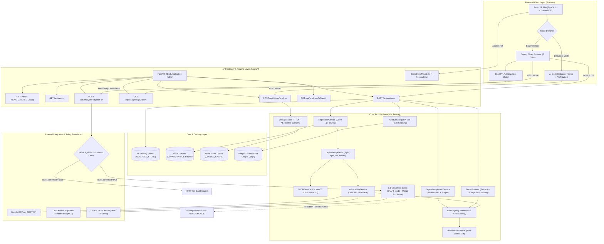

# PATCHPROOF — Technical Architecture Specification

**System Baseline:** v1.0.0 Production  
**Safety Invariant:** `NEVER_MERGE_ACTIVE = True` (Architectural Guarantee)  
**Deployment Model:** Unified Single-Port Production Serving (`http://127.0.0.1:8000`) or Dual-Port Dev (`8000` + `5173`)  
**Repository Path:** `C:\PATCHPROOF`

---

## 1. High-Level Architectural Diagram



---

## 2. Layer-by-Layer Architectural Breakdown

### 2.1 Frontend Client Layer
- **Framework:** React 19 (Functional Components with Hooks).
- **Type Safety:** 100% TypeScript (`types.ts`) with strict schema parity matching backend Pydantic models.
- **Styling & Design System:** Tailwind CSS with dark obsidian theme, semantic severity tokens (Critical `#EF4444`, High `#F97316`, Medium `#FBBF24`, Low `#10B981`), and brand cyan/violet gradients.
- **Iconography:** Lucide React (`Shield`, `KeyRound`, `Bug`, `Lock`, `Wrench`, `GitPullRequest`, `Terminal`).
- **Build System:** Vite 5 with standard tree shaking and chunk splitting:
  - `dist/index.html` (458 B)
  - `dist/assets/index-BedhS8Cr.js` (322 kB)
  - `dist/assets/index-wCvZrhO2.css` (28 kB)
- **Navigation Architecture:**
  - Single-page application with top navbar mode toggle:
    - **`Supply Chain Scanner`**: 7 structured sub-tabs (`Security Dashboard`, `SBOM Inventory`, `Vulnerabilities`, `Secrets`, `Risk & Health`, `Remediations`, `Audit Trail`).
    - **`AI Code Debugger`**: Split-pane interface with code editor textarea, line gutter numbering, preset selector, and localized diff viewer.
  - Interactive Modal: `DraftPRModal` enforcing explicit checkbox state before submission.

---

### 2.2 API Gateway & Server Layer
- **Web Framework:** FastAPI (Python 3.10+ async REST framework).
- **ASGI Server:** Uvicorn with single-worker or reload capabilities.
- **CORS Middleware:** Permissive development CORS (`CORSMiddleware`) allowing cross-port developer setups (`http://localhost:5173`).
- **Static Mounting:** FastAPI `StaticFiles` mounts `frontend/dist` at `/`, allowing the entire application to be served from a single port without reverse proxies.
- **Root Health Check:** `GET /health` returns `{"status": "healthy", "safety_guard": "NEVER_MERGE_ACTIVE"}`.

#### API Route Inventory:
| HTTP Verb | Path | Request Body | Response Model | Description |
| :--- | :--- | :--- | :--- | :--- |
| `GET` | `/health` | None | `dict` | Server health and safety guard verification |
| `GET` | `/api/demos` | None | `List[DemoRepositoryInfo]` | Discovers available demonstration fixtures |
| `POST` | `/api/analyses` | `AnalysisRequest` | `AnalysisResult` | Ingests repo and executes full analysis pipeline |
| `GET` | `/api/analyses/{id}` | None | `AnalysisResult` | Retrieves cached analysis results |
| `GET` | `/api/analyses/{id}/sbom` | Query: `format` | JSON File Attachment | Exports CycloneDX 1.5 or SPDX 2.3 JSON |
| `GET` | `/api/analyses/{id}/findings`| Query: `severity`, `search` | `List[VulnerabilityFinding]` | Filters and searches vulnerability findings |
| `POST` | `/api/analyses/{id}/draft-pr`| `DraftPRRequest` | `DraftPRResponse` | Creates human-confirmed DRAFT pull request |
| `GET` | `/api/analyses/{id}/audit` | None | `List[AuditEntry]` | Returns tamper-evident SHA-256 event stream |
| `POST` | `/api/debug/analyze` | `CodeDebugRequest` | `CodeDebugResponse` | Analyzes code snippet via ML classifier & AST |

---

### 2.3 Core Security Services

#### 1. `RepositoryService` (`repository_service.py`)
- **Ingestion Handlers:**
  - `fixture://<name>`: Resolves locally to `C:\PATCHPROOF\fixtures\<name>`. Computes deterministic 12-char SHA-256 commit hash.
  - `https://github.com/<owner>/<repo>`: Executes `git clone --depth 1` into `%TEMP%\patchproof_repos\<repo>_<hash>`.
- **Defensive Timeouts:** 45-second timeout on Git clone; raises `TimeoutError` if exceeded.
- **Manifest Detection:** Identifies ecosystems (`pypi`, `npm`, `golang`, `maven`).

#### 2. `DependencyParser` (`dependency_parser.py`)
- **Python Parser:** Reads `requirements*.txt` (pinned `==`, `>=`, `<=`, `~=`), `pyproject.toml` (`[dependencies]` and `[tool.poetry.dependencies]`), and `poetry.lock` (package blocks).
- **Node.js Parser:** Reads `package.json` (`dependencies`, `devDependencies`), `package-lock.json` v2/v3 (evaluates `node_modules/` depth for direct/transitive flag), and `package-lock.json` v1 fallback.
- **Golang Parser:** Reads `go.mod` (`require` blocks; flags `// indirect` as transitive).
- **Java Parser:** XML element tree parser for `pom.xml` (`<dependency>` blocks).
- **PURL Normalization:** Generates standard Package URLs (`pkg:pypi/requests@2.19.1`).

#### 3. `SBOMService` (`sbom_service.py`)
- **CycloneDX 1.5 Generator:** Generates UUID v4 serial numbers, tool vendor info, root application component, library nodes with custom `patchproof:*` properties, and root `dependsOn` dependency trees.
- **SPDX 2.3 Generator:** Generates document namespace, CC0-1.0 data license, `SPDXRef-Package-*` entries, and `DESCRIBES`/`DEPENDS_ON` relationships.

#### 4. `VulnerabilityService` (`vulnerability_service.py`)
- **API Batching:** Groups components and calls OSV.dev batch API (`https://api.osv.dev/v1/querybatch`) with 5-second timeout.
- **Semver Range Evaluation:** Implements `is_version_affected()` via `packaging.version.parse` to avoid false positive matching when packages are already fixed.
- **CISA KEV Enrichment:** Checks against `KNOWN_CISA_KEV` catalog (e.g., Log4Shell, requests credential leak, lodash prototype pollution).
- **EPSS Scoring:** Enriches exploit probability (0.0 to 1.0).
- **Resilient Fallback:** Automatically serves high-fidelity local `FALLBACK_ADVISORIES` if network drops.

#### 5. `SecretScanner` (`secret_scanner.py`)
- **File System Scanner:** Walks working tree files under 1MB, skipping binaries.
- **Git Commit History Scanner:** Executes `git log -p -n 10 --unified=0` to inspect added lines across historical commits.
- **12 Secret Regexes:** AWS Access/Secret keys, GitHub PAT/OAuth, Slack tokens, OpenAI keys, Stripe keys, GCP keys, RSA private keys, JWT tokens, and high-entropy secrets.
- **Zero-Leak Redaction:** Immediately runs `redact_secret_string()` (e.g., `AKIA****************`). Raw credentials are never stored or exposed.
- **Incident Playbooks:** Attaches rotation guides from `ROTATION_GUIDES`.

#### 6. `DependencyHealthService` (`dependency_health.py`)
- **Typosquatting Engine:** Computes Levenshtein edit distance between dependency names and a catalog of popular libraries (`requests`, `lodash`, `express`, `django`, etc.). Flags packages with distance <= 2.
- **Lifecycle Script Inspector:** Scans `package.json` for high-risk scripts (`preinstall`, `install`, `postinstall`) invoking `curl`, `wget`, `powershell`, `nc`, or `bash -i`.
- **Scorecard Heuristics:** OpenSSF scorecard penalties for unpinned or unresolved versions.

#### 7. `RiskEngine` (`risk_engine.py`)
- **Deterministic Mathematical Formula:**
  $$\text{Risk} = (\text{CVSS} \times 35) + (\text{KEV} \times 25) + (\text{EPSS} \times 20) + (\text{Reachability} \times 10) + (\text{Health} \times 10)$$
- **Guaranteed Critical Floor:** Active CISA KEV forces individual score >= 82.0 and composite score >= 85.0. Leaked secrets force composite score >= 75.0.
- **Classification Tiers:** Low (0–19.9), Medium (20–39.9), High (40–69.9), Critical (70–100).

#### 8. `RemediationService` (`remediation_service.py`)
- **Safe Bump Solver:** Computes the minimum safe version that resolves all advisories for a package. Downgrades are rejected.
- **Breaking Change Warning:** Flags major version bumps (`target_major > current_major`).
- **Unified Diff Engine:** Uses Python's `difflib.unified_diff()` against the original manifest content.
- **Diff Secret Redaction:** Uses `redact_secrets_in_content()` to sanitize tokens without mangling diff syntax lines.

#### 9. `GitHubService` (`github_service.py`)
- **Draft PR Staging:** Generates structured Markdown pull request bodies.
- **Dry-Run Simulation:** When `GITHUB_TOKEN` is unset or fixtures are evaluated, returns `draft_status: "DRAFT (DRY RUN / SIMULATION)"`.
- **Live GitHub API:** When configured, calls `POST /repos/{owner}/{repo}/pulls` with `"draft": true`.
- **Absolute Merge Denial:** `merge_pull_request()` raises `NotImplementedError` unconditionally.

#### 10. `AuditService` (`audit_service.py`)
- **Event Ledger:** Records UTC timestamped entries for all pipeline lifecycle events (`test_hackathon_readiness.py:Test 10`).
- **Per-Entry SHA-256 Integrity Hashing:** Computes a cryptographic hash over `timestamp:eventType:repository:commitSha:details:actor` for every recorded lifecycle event. Each entry is independently tamper-evident (hashes individual entry metadata; not a recursive blockchain linking previous block hashes).
- **In-Memory Lifetime:** Stored in `audit_logger._logs` in memory; resets upon process restart. Persistent database storage is planned for enterprise roadmaps.
- **Zero Leak Guarantee:** Sanitizes details via `redact_secret_string()` before hashing.

#### 11. `DebugService` (`debug_service.py`)
- **Statistical Model:** Pre-trained scikit-learn TF-IDF Vectorizer + Logistic Regression classifier (`models/bug_detector.joblib`, 607 KB, SHA-256: `5F93BBA9...`).
- **13 Defect Archetypes:** `api_misuse`, `async_error`, `condition_error`, `exception_handling`, `loop_error`, `memory_safety`, `none_correct_code`, `null_pointer`, `off_by_one`, `resource_leak`, `state_management`, `type_error`, `undefined_behavior`.
- **Deterministic AST Workers:**
  - Python: Native `ast` module parses syntax trees, detecting mutable default arguments (`ast.List`, `ast.Dict`), identity comparisons on literals (`ast.Is` on `ast.Constant`), and exception swallowing (`ast.ExceptHandler`).
  - JavaScript / C: Pattern matchers for loose equality (`== 0`), missing await, and format string bugs.
- **Confidence Calibration Guard:** Requires >= 45% statistical confidence OR verified AST confirmation to flag an issue, eliminating false alarms on clean code.
- **Unified Diff Synthesis:** Synthesizes clean fixes and generates diffs via `difflib.unified_diff`.

---

## 3. Data Storage & State Architecture

PATCHPROOF operates with an in-memory, process-isolated caching architecture:

```
+-----------------------------------------------------------------------------------+
|                              DATA & STATE STORAGE                                 |
+-----------------------------------------------------------------------------------+
| Store Name         | Location / Type | Persistence | Description                  |
+--------------------+-----------------+-------------+------------------------------+
| ANALYSES_STORE     | RAM (Dict)      | Process     | Stores active AnalysisResult |
| REPO_PATHS_STORE   | RAM (Dict)      | Process     | Maps analysis ID to disk path|
| _MODEL_CACHE       | RAM (Object)    | Process     | Cached scikit-learn pipeline |
| audit_logger._logs | RAM (List)      | Process     | In-memory audit trail entries|
| Fixtures           | Disk (File)     | Permanent   | C:\PATCHPROOF\fixtures       |
| Model Artifact     | Disk (File)     | Permanent   | C:\PATCHPROOF\models\*.joblib|
| Cloned Repos       | Disk (Temp)     | Ephemeral   | %TEMP%\patchproof_repos      |
+-----------------------------------------------------------------------------------+
```

---

## 4. Machine Learning & Dataset Pipeline (Experiments A–L)

The AI Code Debugger was trained through a rigorous multi-stage experimental curriculum:

1. **Dataset Pipeline (`scripts/datasets/`):**
   - **Schema Definition (`schema.py`):** Canonical JSON schema defining code snippet, language, defect category, severity, faulty line number, and explanation.
   - **Synthesis Engine (`generate_synthetic.py` & `generate_robust_samples.py`):** Synthesizes benchmark code patterns across 13 archetypes and clean control snippets.
   - **Deduplication & Validation (`deduplicate.py`, `validate.py`):** Eliminates duplicate token streams and verifies syntax validity.
   - **Splitter (`split.py`):** Deterministic 80/10/10 train/validation/test split.
2. **Experimental Iterations (F through L):**
   - *Experiment F:* AST structural normalization for Python and JavaScript.
   - *Experiment G:* Token-level lexical representation and confusion matrix auditing.
   - *Experiment H:* Dual-channel tokenization (lexical tokens + AST grammar nodes).
   - *Experiment I:* Hybrid rule + ML classification fusion engine.
   - *Experiment J:* Calibration tuning and false-positive reduction on clean controls.
   - *Experiment K:* Cross-dataset generalization and final model export (`bug_detector.joblib`).
   - *Phase L1/L2:* Dual-channel tokenizer ablation and feature fusion evaluation.

---

## 5. Security Architecture & Boundary Invariants

```
+------------------------------------------------------------------------------------+
|                             SECURITY BOUNDARY ENFORCEMENT                          |
+------------------------------------------------------------------------------------+
| Guard Name             | Mechanism                      | Enforcement Location     |
+------------------------+--------------------------------+--------------------------+
| NEVER_MERGE_ACTIVE     | Prohibited merge endpoints     | config.py, endpoints.py, |
|                        | NotImplementedError in service | github_service.py        |
+------------------------+--------------------------------+--------------------------+
| SSRF Defense           | IP / Hostname Blacklisting     | security.py:             |
|                        | RFC 1918 private IP rejection  | validate_repository_url  |
+------------------------+--------------------------------+--------------------------+
| Authorization Gate     | Mandatory user_confirmed bool  | endpoints.py:            |
|                        | HTTP 400 rejection on omitted  | create_draft_pull_request|
+------------------------+--------------------------------+--------------------------+
| Zero-Leak Redaction    | Automatic regex & entropy mask | security.py:             |
|                        | Visible prefix/suffix clamp    | redact_secret_string     |
+------------------------+--------------------------------+--------------------------+
| Static Execution Safety| AST parsing without eval()     | debug_service.py         |
|                        | Subprocess timeout limits (45s)| repository_service.py    |
+------------------------+--------------------------------+--------------------------+
```

